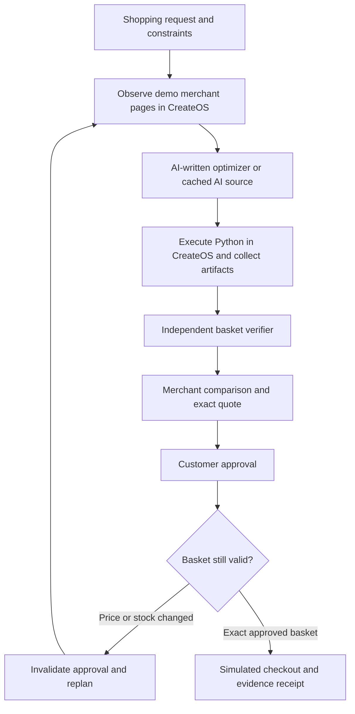

# CartPilot

### Your errands. Your rules.

An agentic shopping assistant that **runs code to plan a basket, verifies the result, and asks before it spends**. Built for the **CreateOS × Stripe Projects hackathon**.

**[Open the live demo](https://01m55q139gyy1y1x3m45qvt620-4173.app.sb.createos.sh)** · **[View the Stripe Projects stack](https://projects.dev/s#v1:createos~project)** · **[Demo guide](DEMO.md)** · **[Verification evidence](VALIDATION.md)**

> **Try it:** “Movie night for four. Snacks, drinks and something sweet. Peanut-free, under $35.”
>
> CartPilot compares three merchants, includes fees and tax, checks the basket, and requests approval. Change a price or sell out an item to watch the old approval become invalid and the agent recover.

The live demo runs inside a **real CreateOS sandbox**, exposed through public HTTPS ingress. It can sleep after inactivity; the operator can run `npm run resume:demo` to wake the existing workspace.

## Why CartPilot?

A shopping agent needs to handle what happens **between making a plan and placing an order**. Prices change, stock disappears, and permission to spend must stay attached to the basket the customer actually reviewed.

CartPilot makes that boundary visible. The agent proposes a solution through executable code. A separate verifier checks the result. A changed basket needs fresh permission, and every step leaves evidence you can inspect.

This is a Blinkit-inspired quick-commerce study with **fictional merchants, sample inventory, USD prices and illustrative delivery estimates**. It has no Blinkit affiliation or live grocery-ordering integration.

## What you can demonstrate

- **Intent to executable code:** an isolated coding agent writes a Python optimizer, which runs in CreateOS. Inspect its source, stdout, exit code and downloaded `plan.json`.
- **Three-way merchant comparison:** 36 products and 108 offers across Flash Basket, Fresh Lane, and Corner & Co.; the selected basket must satisfy the requested servings, dietary exclusions, budget and delivery window.
- **Browser-backed observation:** Playwright Chromium opens the three demo merchant storefronts, reads their offers, and saves screenshots. Observation failures are labeled and fall back to the fixture catalog.
- **Independent verification:** prices, quantities, stock, serving coverage, dietary metadata, delivery estimates, fees and tax are checked outside the generated program.
- **Scoped spending approval:** permission binds the merchant, basket fingerprint, exact total, spending limit and expiry.
- **Recovery you can trigger:** inject a $5 price increase or a stockout, invalidate the previous approval, and replan before checkout.
- **Inspectable receipts:** repeated checkout for the same approved intent returns the same simulated receipt. Export the checks, execution details and event journal as JSON.

## A two-minute walkthrough

1. Open the demo and select **Movie night**. Keep four people, a $35 budget and **No peanuts**.
2. Choose **AI-generated optimizer (fast)** and select **Plan my basket**.
3. Open **Agent workspace** to inspect execution and merchant comparison. Open **Proof & receipts** for the independent checks and browser screenshots.
4. Review and approve the basket in the **wallet policy simulator**.
5. Before checkout, select **Price jumps $5** or **Item sells out**. The old approval is invalidated. Select **Recover & replan**, then review and approve the new basket.
6. Complete the simulated order and download the evidence report.

**No real money is charged and no real groceries are ordered in this flow.** See [DEMO.md](DEMO.md) for presentation notes.

## How it works



Browser observation is optional. If AI execution or validation fails, one repair attempt can use the failure message to generate corrected code.

### AI generation and memory

The default generator uses the **official OpenCode CLI with the free Big Pickle model** inside CreateOS. A successful AI-written optimizer persists in sandbox memory and runs again against fresh inputs. The interface distinguishes:

| Planner | Behavior |
| --- | --- |
| AI-generated optimizer (fast) | Reuses AI-written source from persistent memory; generates it if no memory exists. |
| Write fresh AI code | Requests a new program; takes longer. |
| Reference optimizer | Runs bundled Python and makes no model call. |

Cached execution is labeled as cached execution. It is not presented as a new AI generation. The verified generation reported $0 provider cost; provider availability can change, and no paid fallback is automatic.

## CreateOS and Stripe: integration status

| Integration | What it does | Current status |
| --- | --- | --- |
| **CreateOS Sandbox SDK** | Persistent microVM, isolated Python execution, file transfer, restricted egress, browser automation and idle auto-pause/resume | **Working and verified** |
| **CreateOS public ingress** | Serves the current app and a separate managed workspace monitor | **Working and verified** |
| **Stripe Projects** | Provisions and manages the linked CreateOS provider resource and credentials | **Connected**; [shareable stack](https://projects.dev/s#v1:createos~project) |
| **Wallet policy simulator** | Exercises exact approval, invalidation, expiry and simulated checkout | **Working and verified**; no payment occurs |
| **Link Agent Wallet + Stripe MPP** | Optional buyer authorization and test-payment verification | **Implemented, not verified end to end**; Link account/country restrictions block the operator, and seller test settings are not configured |

The simulator is **not a Link authorization or Stripe payment**. Real test commerce requires a separately authorized buyer, a Stripe test secret key, and a `profile_test_` ID. Live seller keys and live profiles are rejected. Public demo mode disables use of the operator's local wallet authorization.

The separate CreateOS hosting environment is still awaiting runtime reconciliation. The **sandbox ingress URL at the top of this README is the verified public demo**.

## Technology stack

| Layer | Technology |
| --- | --- |
| Interface | React, Vite, Lucide icons, custom responsive CSS |
| Application API | Node.js HTTP server |
| State | SQLite through `node:sqlite` |
| Execution platform | CreateOS Sandbox SDK, Linux microVM, Python |
| Browser observation | Playwright Chromium inside CreateOS |
| Code generation | Official OpenCode CLI; persistent AI source memory |
| Provider provisioning | Stripe CLI and Stripe Projects plugin |
| Optional test commerce | Stripe SDK, official Link CLI, `mppx` |

## Run locally

Use **Node.js 24**, npm and Git. The shopping flow requires CreateOS credentials; the app does not substitute a fake successful execution when credentials are missing.

```bash
git clone https://github.com/AdvayV/CreateOS-X-Stripe-Hack.git
cd CreateOS-X-Stripe-Hack
npm ci
```

For the project owner, restore provider credentials through the initialized Stripe Projects context:

```bash
stripe projects status
stripe projects env --pull
```

For a separate account, initialize your own Stripe project and provision your own CreateOS resource using the [shared stack](https://projects.dev/s#v1:createos~project). Do not reuse someone else's credentials.

Keep application settings in an ignored `.env.app`, using [`.env.example`](.env.example) as a guide. Leave the CLI-managed `.env` under Stripe Projects control.

```bash
npm run build
npm start
```

Open **http://localhost:4173**. For development, use `npm run dev`. On Windows, use `npm.cmd` or `stripe.cmd` if PowerShell blocks script launchers.

### Configuration

| Variable | Purpose |
| --- | --- |
| `CREATEOS_PROJECT_API_KEY` or `CREATEOS_SANDBOX_API_KEY` | Authorizes sandbox operations; keep private. |
| `CARTPILOT_SANDBOX_ID` | Reuses an existing workspace. If omitted, the local state file is checked before creating one. |
| `CARTPILOT_AI_ENABLED` | Enables the generation allowance; disabled in the example configuration. |
| `CARTPILOT_AI_PROVIDER` | Defaults to `sandbox` for the OpenCode generator. |
| `CARTPILOT_BROWSER_OBSERVE` and `PUBLIC_ORIGIN` | Enable observation of the configured demo storefronts. |
| `PUBLIC_DEMO` | Disables local operator administration and wallet access when `true`. |
| `STRIPE_TEST_SECRET_KEY` and `STRIPE_TEST_PROFILE_ID` | Optional test-only MPP seller settings; unnecessary for simulator checkout. |

The local server binds to loopback by default. Deployment explicitly binds to `0.0.0.0` on port `4173`. Existing credits fund sandbox usage; the app does not automatically upgrade plans or buy credits.

## Verification

```bash
npm test
npm run build
```

**Verified on 18 October 2026:** all 29 automated tests passed. The real CreateOS end-to-end flow passed both locally and through public sandbox ingress, including price/stock recovery, approval invalidation, repeated checkout, session isolation and report export. The demonstrated basket passed 16 independent checks. Chromium observed all 108 offers and passed desktop/mobile checks with no page errors or horizontal overflow.

To exercise the API flow against a running local server:

```bash
node --use-system-ca --use-env-proxy scripts/cart-e2e.mjs
```

Set `CARTPILOT_TEST_URL` to test another deployment and `CARTPILOT_EXPECT_BROWSER=true` to require successful browser observation. These tests use CreateOS resources. Run local and deployed workloads sequentially when sharing a single sandbox.

See [VALIDATION.md](VALIDATION.md) for evidence, limitations and the distinction between test results and payment settlement.

## Repository guide

| Path | Responsibility |
| --- | --- |
| `src/CartPilot.jsx`, `src/cart.css` | Shopping interface, execution journal, approval and proof views |
| `src/MerchantStore.jsx` | Rendered demo merchant storefronts |
| `server/cart-server.mjs` | Session-scoped jobs, quote lifecycle, checkout and evidence APIs |
| `server/cart/` | AI generation, sandbox execution and optional Link approval |
| `shop/` | Catalog, intent mapping, browser observer, reference planner and independent verifier |
| `tests/shopping.test.mjs` | Basket and approval contracts |
| `scripts/cart-*.mjs` | Verification, sandbox publishing, resume and deployment helpers |

Deployment helpers are configured for this repository's existing CreateOS resources. Review resource IDs and configuration before using them with another account. The Dockerfile and clean source-bundle helper support the separate hosting path. Generated artifacts, credentials and local runtime state are excluded from Git.

## Demo limits

- Dietary checks rely on fictional catalog metadata; they are not real-world allergy assurances.
- Explicit snapshots can take several minutes, so the fast demo uses idle auto-pause. A sleeping workspace may need an operator resume.
- Demo SQLite state and screenshots belong to the current runtime. Export evidence before replacing it; local hosted storage is not a production database guarantee.
- This is a hackathon prototype with no real merchant fulfillment or verified payment settlement.

The earlier **Rehearsal** Stripe billing-reliability lab remains available through `npm run lab` at `/?lab`. See [REHEARSAL.md](REHEARSAL.md). **CartPilot is the main hackathon project.**
